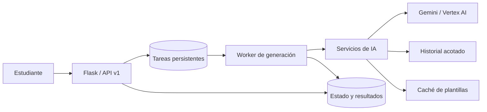

# ApuntAI · Backend & AI Integration

**De documentos y temas de clase a material con el que estudiar.**

Soy Raúl Niño Alonso. Desarrollo ApuntAI, una plataforma EdTech con backend, integración de IA y herramientas de estudio: apuntes, preguntas sobre el contenido, flashcards, mapas conceptuales y simulación de exámenes. Este repositorio reúne cuatro muestras de su arquitectura para enseñar cómo resuelvo problemas de ingeniería en un producto real.

Busco prácticas de **Junior Backend / AI Integration**. Me interesa construir el servicio que conecta una idea de producto con una experiencia que funcione para quien la usa: una API comprensible, una generación que no bloquee la petición web y un contexto de conversación que no crezca sin control.

## El proyecto

ApuntAI tiene una arquitectura para producción con procesos web y worker separados, persistencia de tareas, migraciones, autenticación, pagos y comprobaciones de salud. El código original también incluye pruebas de contratos de API, permisos, colas y recuperación de errores. Esta selección permite revisar las decisiones técnicas sin publicar el producto completo.

| Capa | Tecnologías del proyecto |
| --- | --- |
| Backend y API | Python, Flask, Blueprints, Gunicorn |
| Persistencia | SQLAlchemy, Flask-Migrate / Alembic; PostgreSQL y SQLite en desarrollo |
| IA | Google Gen AI SDK, Gemini, configuración para Vertex AI |
| Procesamiento | PDFs, imágenes y documentos; generación de materiales de estudio |
| Interfaz | JavaScript modular, Jinja, HTML/CSS; Capacitor para clientes móviles |
| Operación | Worker de cola en base de datos, límites configurables, health/readiness checks |

El backend de esta versión está escrito en Python. Node.js se utiliza en las herramientas de Capacitor. La integración de IA se organiza mediante servicios especializados; las muestras no incluyen un servidor MCP ni un bucle de agentes autónomos.

## Cómo encajan las piezas



La petición web puede iniciar una tarea y consultar su estado mientras el worker ejecuta el trabajo. Los servicios separan responsabilidades por herramienta. Las respuestas v1 tienen un contrato común y pueden incluir un identificador de petición para investigar errores.

## Code Tour

Si tienes cinco minutos, empezaría por el contrato de API y seguiría con el worker.

### 1. [Contrato de API](code/api_response.py)

**Origen:** `routes/api/response.py` · módulo completo con nota de procedencia.

`api_ok()` y `api_error()` dan una forma consistente a las respuestas. `normalize_legacy_result()` adapta respuestas antiguas al contrato v1: permite evolucionar la API sin reescribir todas las rutas de golpe. Los errores separan código, mensaje y detalles, y mantienen el `request_id` cuando está disponible.

**Qué demuestra:** diseño de contratos, compatibilidad durante una migración y atención a quien consume y depura la API.

### 2. [Worker de generación](code/generation_worker.py)

**Origen:** `services/generation_worker_service.py` · módulo completo con nota de procedencia.

`process_pending_generation_jobs()` lee tareas pendientes y las dirige al ejecutor correspondiente. El worker controla intentos, espera entre reintentos, revisa tareas que han excedido su timeout y aplica límites de tareas marcadas como activas, tanto globales como por tipo. Cada ejecución transporta su número de intento al ejecutor.

**Qué demuestra:** ciclo de vida de tareas, recuperación ante fallos y control de recursos. El procesamiento del lote es secuencial. La consulta y el cambio de estado no forman una adquisición atómica: para varios workers simultáneos habría que añadir bloqueo o reclamación atómica de tareas.

### 3. [Fachada de servicios de IA](code/ai_facade.py)

**Origen:** `services/ai/__init__.py` · módulo completo con nota de procedencia.

`LazyAIService` aplaza la construcción del servicio hasta el primer acceso. El paquete conserva una interfaz común mientras separa chat, apuntes, imágenes, podcasts y otras herramientas en módulos. Las exportaciones diferidas mantienen la compatibilidad con los imports existentes.

**Qué demuestra:** modularización, carga diferida y evolución de una base de código. La fachada utiliza herencia múltiple; al ampliar el sistema, la composición explícita facilitaría aislar dependencias y probar cada integración.

### 4. [Contexto y caché](code/context_optimization.py)

**Origen:** extractos de `services/ai/chat_service.py` y `services/ai/concept_map_service.py`.

`_compact_history()` elimina entradas vacías y duplicados consecutivos del mismo rol. `_build_history_text()` prioriza mensajes recientes y limita su longitud. `_get_template()` conserva la plantilla de mapas conceptuales en memoria tras la primera lectura.

Los cuerpos de estos métodos se conservan. Se han retirado la herencia que inicializa el proveedor, los prompts de producto, los lectores de documentos y las llamadas al modelo. La plantilla HTML privada tampoco se distribuye; las pruebas usan una muestra sintética.

**Qué demuestra:** presupuestos de contexto y reutilización de recursos. La caché es local a cada proceso y dura hasta su reinicio; los límites del historial están expresados en caracteres.

## Resultados que se pueden comprobar

| Decisión | Evidencia verificable |
| --- | --- |
| Acotar el historial enviado al modelo | Se seleccionan como máximo 12 mensajes; sus líneas suman hasta 9.000 caracteres, más separadores y cabecera |
| Evitar que una respuesta larga monopolice el contexto | Hasta 1.400 caracteres por mensaje de usuario y 900 por respuesta del asistente |
| Quitar repetición innecesaria | Se omiten mensajes vacíos y duplicados consecutivos normalizando mayúsculas y espacios |
| Reutilizar la plantilla | Dos accesos consecutivos realizan una sola lectura de archivo en la prueba |
| Recuperar trabajo bloqueado | Timeout y reintentos configurables; valores por defecto de 600 segundos y 3 intentos |
| Aplazar la carga de IA | Importar la fachada no construye el servicio; el proxy lo solicita al primer acceso |

Estas decisiones acotan el texto de entrada y evitan trabajo repetido. Para cuantificar su impacto en coste y latencia mediría tokens de entrada/salida, coste por tarea y latencia p50/p95 con el mismo conjunto de conversaciones, modelo y configuración. No hay un benchmark incluido que permita atribuir una reducción del 80 % a esta versión.

## Ingeniería con criterio de producto

Mi trabajo conecta implementación y experiencia de estudio. El producto ofrece distintos formatos porque repasar con preguntas, ordenar un tema en un mapa y resolver una duda requieren interacciones distintas. El chat contempla idioma, longitud y preferencias de respuesta; el historial reciente ayuda a mantener continuidad.

Las decisiones de backend también afectan a esa experiencia: los estados de tarea permiten mostrar progreso, un contrato estable hace más sencillo gestionar errores y los límites de contexto ayudan a mantener el consumo bajo control. Me interesa entender el problema del estudiante y traducirlo en decisiones concretas de interfaz, datos y servicios.

## Revisar las muestras

Las cuatro muestras son código de lectura; no constituyen una aplicación desplegable. API, worker y fachada conservan imports hacia módulos internos excluidos. Las pruebas sustituyen esas dependencias con dobles locales y no acceden a la aplicación original, bases de datos ni proveedores de IA.

Desde la raíz de este showcase, con Python 3.10 o posterior:

```bash
python -m venv .venv
# macOS / Linux
source .venv/bin/activate
# Windows PowerShell
# .venv\Scripts\Activate.ps1
python -m pip install -r requirements.txt
python -m unittest discover -s tests -v
```

Las pruebas cubren el contrato de respuesta, orden y límites del historial, deduplicación, reutilización de plantilla, carga diferida y transiciones de reintento. Son comprobaciones locales de las muestras; no reemplazan las pruebas de integración del producto.

## Alcance público

Esta carpeta puede publicarse como repositorio independiente. Incluye únicamente las muestras seleccionadas, documentación y pruebas con datos sintéticos. Se excluyen configuración de despliegue, credenciales, datos de usuarios, bases de datos, uploads, prompts de producto, reglas comerciales y el historial Git del proyecto original.

Los imports internos documentan la arquitectura, pero sus implementaciones privadas no se distribuyen. Si se incorporan nuevas muestras, los valores secretos deben sustituirse por `[REDACTED]` antes de publicar.

**Autor:** [Raúl Niño Alonso · GitHub](https://github.com/raauln)
